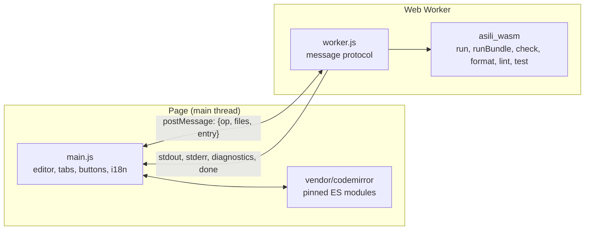

# Asili Playground — Technical Requirements Document

As of 7 November 2026 · Victor Kaiuki

The playground stays a static page: HTML, one ES module, vendored CodeMirror and wasm built from the
Asili repo. New tools arrive as new exports of the wasm build, called from a Web Worker. This
document implements the [Product Requirements Document](01-product-requirements.md) (PG-n).

## Architecture

- The worker owns the wasm instance. The page posts `{op: "run" | "check" | "format" | "lint" |
  "test", files, entry}` and receives `out`, `err`, `diag`, `done` messages. Stop is
  `worker.terminate()` followed by a fresh worker.
- `globalThis.asili_nguvu_load` (native code from `nguvu` instantiates through it, see Asili's
  `driver/wasm/README.md`) must be defined in the worker scope before the module initialises.

## Wasm exports

Today `asili-wasm` exports `run(source)` and `runBundle(entry, modules)`; errors return as one
string. Required (work in the Asili repo, `driver/wasm`):

| Export | Returns | Backs | Built on |
| --- | --- | --- | --- |
| `run`, `runBundle` | Output through `console`; error | PG-4, PG-5 | Exists |
| `runBoard(source, triples)` | Output through `console`, board events tagged on the console channel | PG-4, board | Exists (`driver/wasm`, `platform::write_event`) |
| `check(source)` | JSON array of `{line, column, code, message}` (`[]` when clean); one file for now | PG-3, PG-8 | The CLI's compile front end (`parse_tokens` + `semantic_check_with_env`), not a second checker. Multi-file `check(files)` follows `runBundle` |
| `format(source)` | Formatted source or a diagnostic | PG-6 | `pata-fmt` library |
| `lint(files)` | Findings: rule code (`LINT001`…), line, message | PG-7 | `pata-lint` library |
| `test(files)` | Per-test pass or fail and output | PG-9 | Same runner as `pata jaribu` (`NativeProgram::run_function`) |
| `trace(files)` | Trace events as JSON | PG-14 (v2) | `asili-trace` |

Status of this table: `run`, `runBundle` and `runBoard` exist; `check` is the next export (task 11).

Every export reuses the crate the CLI uses, so the playground cannot disagree with `pata` (Asili's
write-once rule). Runtime errors also need a line: `run` should return structured errors, not only a
string.

Feasibility to confirm first: since Asili `4bfe016`, `pata-fmt` and `pata-lint` are libraries only
(`pata nadhifu` and `pata kagua` call them) and no longer depend on `clap`; they still depend on
`pata-config`, `toml` and `serde`. Their string-in, string-out APIs must build for
`wasm32-unknown-unknown` without touching the file system. If `pata-config`'s file lookup gets in
the way, put it behind a feature flag.

## Editor

- CodeMirror 6, vendored as pinned pre-bundled ES modules under `vendor/`, regenerated by
  `scripts/vendor.sh` (run by a maintainer, not at build time). Removes the five `esm.sh` imports.
- Asili highlighting stays a `StreamLanguage` whose keyword and type lists are generated from the
  compiler (the Asili repo's `editor_word_lists` test already checks `main.js` against
  `asili_lexer::KEYWORDS` via `ASILI_PLAYGROUND_DIR`).
- Diagnostics are line decorations (a `StateField` of `Decoration.line`, from the vendored
  `@codemirror/state` and `@codemirror/view`), with the message as the line's `title`. This does not
  vendor `@codemirror/lint`: it would be a new npm package, and the two packages already pinned are
  enough. Revisit if gutter markers or a diagnostics panel are wanted.

## Files, sharing and embedding

- Files live in memory as `{name: source}`; the first file is the entry unless the user marks
  another. The sample manifest gains an optional `files` list for multi-file samples.
- Share link: `#k=` + base64url of deflate-compressed JSON of the files (`CompressionStream`, no
  library). Over about 8 KB of URL, warn that the link may be too long for some apps.
- `?embed=1&sample=<id>` or `?embed=1#k=…`: hides the header, gallery and tool bar; shows the
  editor, Run and output; sized for an `<iframe>`.
- Language: `?lugha=` then `localStorage` key `asili-lugha` (shared with the website) then `sw`.
  All strings live in `i18n/sw.json` and `i18n/en.json`.

## Samples

- `samples/manifest.json` grows from 3 to one sample per language area (the wiki's Language Tour
  sections) and per browser-capable stdlib module, each tagged with an area.
- CI runs every sample through native `pata` and through the wasm build and compares output, the
  same agreement the Asili repo's `driver/wasm/tests/agree.sh` checks for examples.

## Hosting and self-hosting

- Hosted: the website repo's `site.yml` builds the wasm (`build.sh`, `ASILI_DIR` = an Asili checkout
  at `main`) and copies the playground into `public/playground/` (see the website's Technical
  Requirements). This repo's CI sends a `repository_dispatch` to the website on push to `main`.
- Self-hosted: `build.sh`, then `pata jenga --tenda` serves the directory with the existing Asili
  static server (`src/kuu.as`). Only relative paths, so both work unchanged.

## CI

| Check | Fails when |
| --- | --- |
| Word lists match the compiler (exists) | Highlighter lists drift from Asili |
| Samples agree with native `pata` | Any sample's output differs |
| Wasm size budget | Gzipped wasm over budget |
| No external requests | A built page references a URL outside the site |
| Lint and format of `main.js` and `worker.js` | Style errors |
