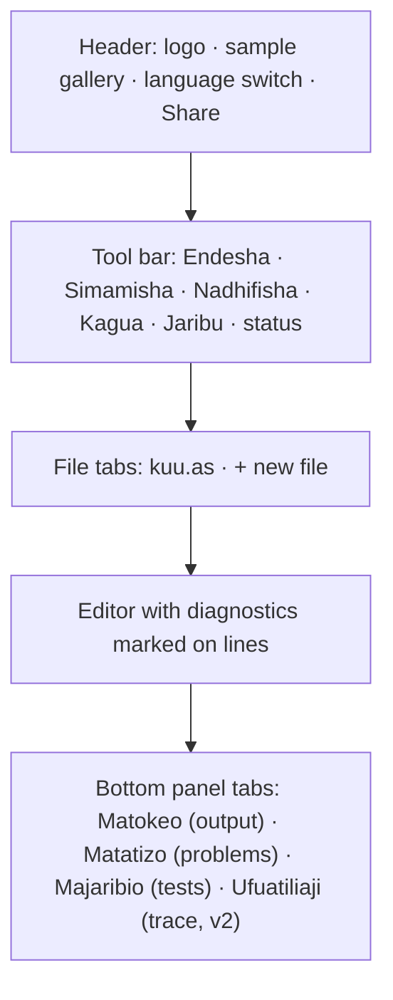
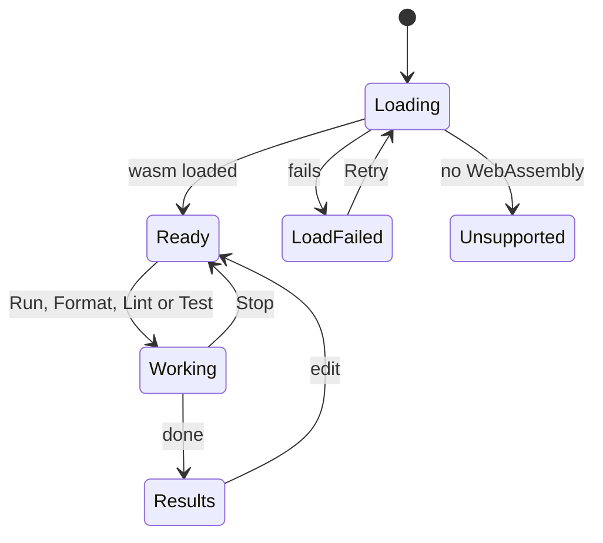

# Asili Playground — App Flow

As of 7 November 2026 · Victor Kaiuki

The playground opens with a runnable sample, keeps the editor usable while the wasm loads, and puts
every tool one click away in the tool bar.

## Layout regions

## States

Typing works in every state except Unsupported. Check-as-you-type runs in Ready and Results, with
a short pause after the last keystroke.

## Flow 1: run and fix

1. Opens `/playground/` (or a share link): the Karibu sample loads in Swahili.
2. Presses **Endesha** (or Ctrl+Enter): output streams into Matokeo.
3. Introduces a mistake: the line gets a red underline as they type; hovering shows the Swahili
   message and code; Matatizo lists it.
4. Fixes it; the mark clears; runs again.
5. A program that never ends: **Simamisha** stops it; output so far stays.

## Flow 2: try the toolchain

1. **Nadhifisha** reformats the active file with `nadhifu` rules; undo restores the old text.
2. **Kagua** runs `pata-lint`; findings appear as yellow underlines and in Matatizo with their rule
   code.
3. **Jaribu** runs every `#[jaribio]`; Majaribio lists pass and fail with output per test.
4. v2: **Ufuatiliaji** shows the last run's trace as a tree.

## Flow 3: several files

1. Clicks **+** to add `msaada.as`; writes a function there.
2. In `kuu.as`, `leta msaada` imports it; Run uses `runBundle` with both files.
3. A diagnostic in `msaada.as` marks that tab with a dot.

## Flow 4: share and embed

1. **Shiriki** copies a link holding all files; a note says the code is in the link, not on a server.
2. Opening the link restores the files and the language.
3. The website and wiki embed `?embed=1&sample=<id>`: a compact editor with Run and output only, and
   an "Fungua kwenye uwanja" (open in playground) link to the full page.

## Flow 5: explore features

1. Opens the sample gallery: samples grouped by area (basics, types, errors, structs and traits,
   collections, concurrency, and one group per stdlib module).
2. Picking a module that cannot run in a browser (for example a file-system module) shows the
   browser support note instead of failing at run time.

## Edge cases

| Situation | What the user sees |
| --- | --- |
| JavaScript off | A message that the playground needs JavaScript, and a link to install Pata |
| No WebAssembly | "Kivinjari hiki hakiwezi kuendesha Asili", with supported browsers |
| Wasm fails to load | Error state, Retry; the editor keeps its text |
| Share link too long | Warning before copying; suggestion to remove files |
| Share link corrupt | Opens the default sample with a notice |
| Format of code that does not parse | Matatizo shows the parse error; the text is unchanged |
