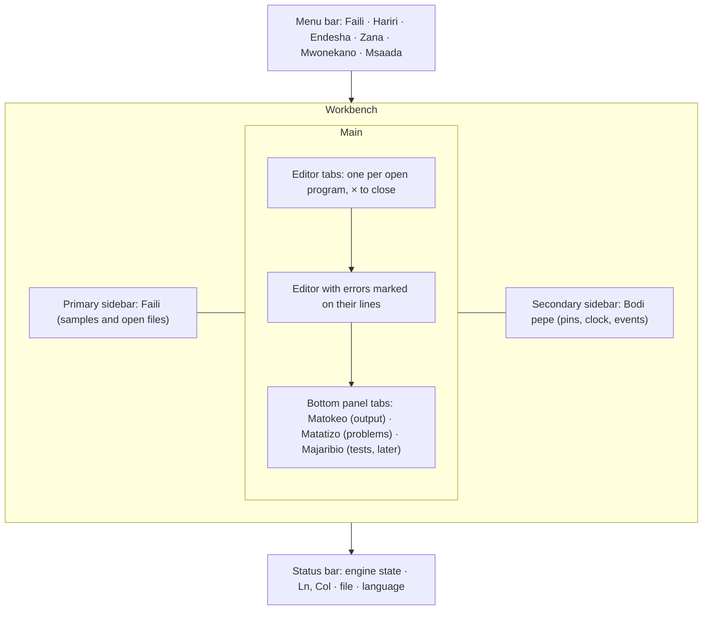
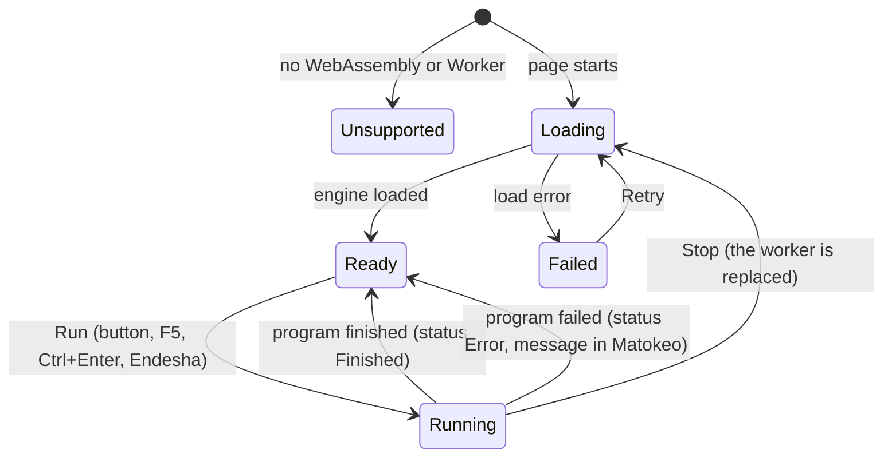
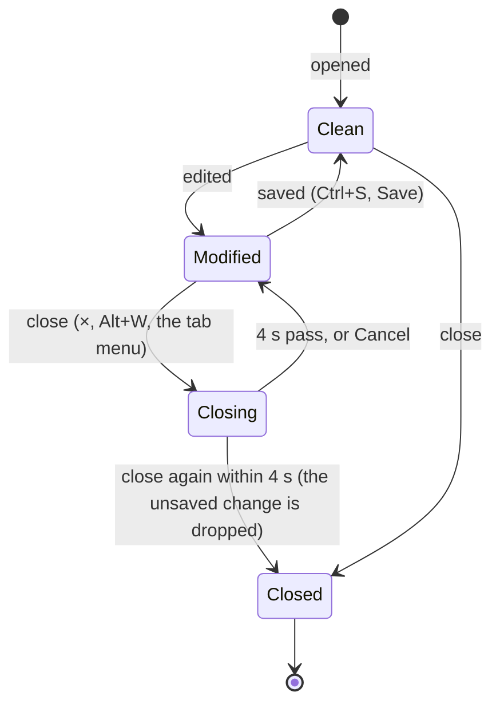
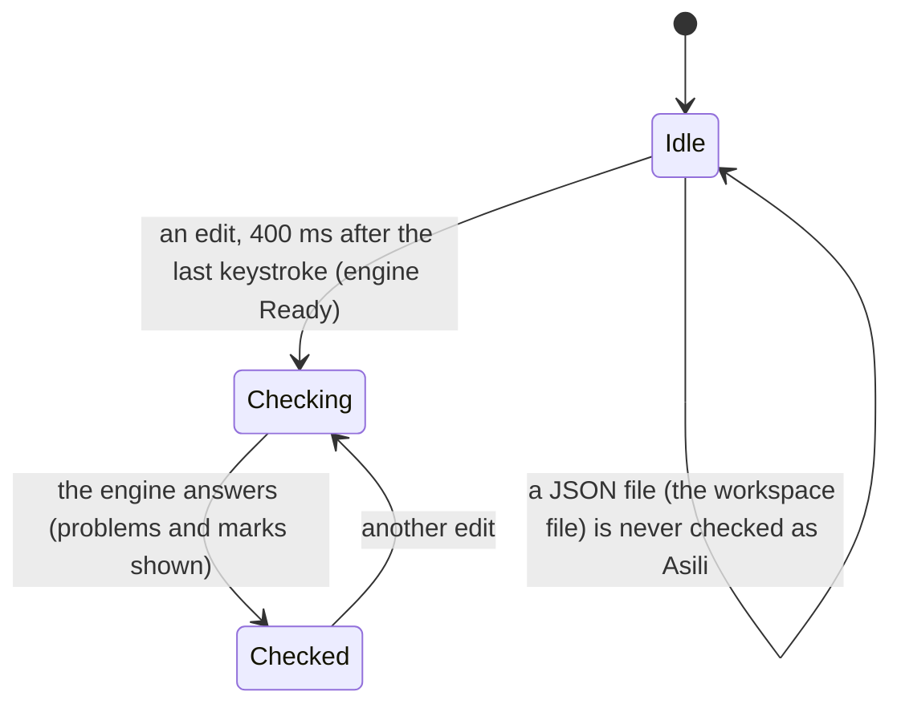
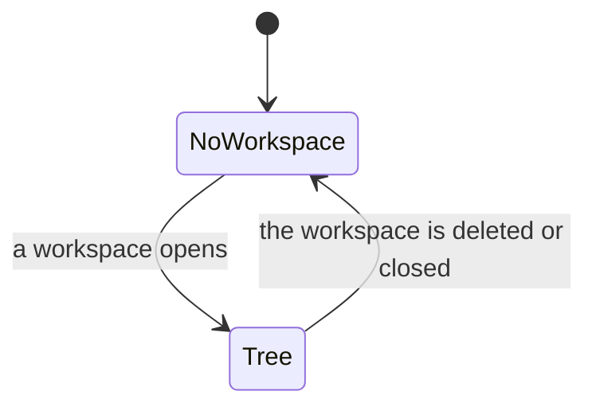

# Asili Playground — App Flow

As of 7 November 2026 · Victor Kaiuki

The playground opens with a runnable sample, keeps the editor usable while the wasm loads, and puts
every tool one click away in the tool bar.

## Layout regions

The page is an IDE shell. Every region has a fixed place, so the editor is never pushed around by a
panel opening.

- **Menu bar** holds every command. A menu item that is not built yet is shown disabled, not hidden.
- **Primary sidebar** lists the samples and the open files. Choosing a sample opens it in a tab.
- **Editor tabs** keep one program each. Switching tabs keeps each program's text.
- **Secondary sidebar** shows the virtual board. Collapsing it gives the editor the width.
- **Bottom panel** is tabbed. Matatizo lists each diagnostic; choosing one moves the cursor to its line.
- **Status bar** shows the engine state (Ready, Running, Error), the cursor position, the open file
  and the interface language.

The layout is data, not markup. `layout.js` holds a registry of **menus**, **sidebar sections**
(primary and secondary), **bottom-panel tabs** and **status items**. Each entry has an `id`, a label
key in the string table, an `order` and what it renders or does. `renderShell()` builds the page from
the registry, so the page HTML only has the root element. To add a feature, register an entry; no
other file changes. Entries are checked when registered: a duplicate `id` is an error, so two
features cannot silently replace each other.

Narrow screens (under 760 px) stack the regions in the order of the list above, with each sidebar
collapsed by default.

## States

The machines are declared in `states.js`: each state, each transition and its event. The page sends
events to them and reads the engine's flags from them; the workspace, the Explorer and the main area are
derived from the page's data by one function, so they cannot disagree with it. `scripts/test_states.mjs`
checks every transition in the tables and that every state can be reached.

Every state the page can be in, grouped by what it describes. Each machine has one start state, and
each transition names its trigger. A trigger is any of: a menu item, a command-palette entry, a key,
a button, or an event from the engine or the browser. Where a state is shown, the UI says which one
it is. The machines run side by side: the engine, the workspace, each file, the checks, the views,
the main area and the overlays.

### Engine

| State | What the user sees | Leaves on |
| --- | --- | --- |
| Loading | status "Loading…", Run disabled | the engine's ready message, or its load error |
| Ready | status "Ready", Run enabled | Run |
| Running | Run hidden, Stop shown, status "Running…" | the program ends (Finished or Error), or Stop |
| Failed | notice "The engine failed to load" with Retry | Retry |
| Unsupported | notice; no engine; editing still works | (end state) |

Stop replaces the worker, so the next state is Loading, then Ready. The status says Stopped.

### Workspace

```mermaid
stateDiagram-v2
  [*] --> None: first visit, before a sample opens
  None --> Clean: a sample, a new workspace, or a shared link opens
  Clean --> Dirty: an open file's text differs from its saved text
  Dirty --> Clean: Save
  Clean --> None: Close workspace (kept, listed under Open Recent)
  Dirty --> None: Close workspace asks: Save, then close; Don't save, then close; Cancel stays
  Clean --> None: Delete workspace (removed for good, after a dialog with a Delete button)
  Dirty --> None: Delete workspace asks as well; the unsaved changes are dropped
  Dirty --> Clean: switching asks: Save, then open
  Dirty --> Clean: switching asks: Don't save, then open
  Dirty --> Dirty: switching asks: Cancel (stays open)
```

- **None** shows the Explorer's empty state (New workspace, Open workspace, Open sample), and the main
  area's empty state when no file is open.
- **Clean** and **Dirty** are the same workspace; Dirty only adds the unsaved-change mark on its tabs
  and in the file list.
- **Close workspace** and **Delete workspace** are different. Close keeps the workspace saved (it stays
  under Open Recent and Open workspace); Delete removes it, after a confirmation dialog.
- **Switching** from a Dirty workspace always asks first. The dialog's buttons are Save, Don't save and
  Cancel.

### Open files (one per tab)

The machine is `document` in `states.js`. Clean and Modified are derived on every tab change from the
file's text against its saved text (`syncDocStates` in `main.js`); Closed is set when the file leaves
the tabs (`forgetDoc`). Closing is not a machine state: it is the warning flag on the file (`closeArmed`),
which lasts 4 s.

- Exactly one file is **Active**: its text is the editor's. Switching tabs keeps each file's undo
  history and cursor.
- Closing the last open file moves the main area to its **empty state**.

### Checks (diagnostics)

Every file of the workspace is checked, not only the one in the editor: the Problems panel lists them
all. A file that is a module reports "no main function" only if it is `kuu.as`.

### Lint and format

- **Lint file** runs the linter once and holds its findings (state **shown**). An edit makes them
  **stale**: they stay listed, dimmed and marked "the file changed since it was linted", until Lint runs
  again. Switching files drops the findings of the file being left.
- **Format document** replaces the text with the formatted text as one edit (Undo restores it). If the
  text is already formatted, the page says so and changes nothing.

### Explorer

- **NoWorkspace**: the empty state. The toolbar's New file, New folder and Collapse are off.
- **Tree**: the workspace root, folders (Expanded or Collapsed; remembered per workspace) and files.
- A file or folder can also be **Renaming** (its name is an input) or **Confirming delete** (its menu
  item asks again). Escape or a click away ends Renaming; the second click ends Confirming.

### Main area

- **Editor**: the active file is shown and the header lists the open files.
- **Empty**: no file is open. The editor is hidden; the page offers New workspace, Open sample and Open
  recent. This state is kept across a reload.

### Views and regions

- Each region (left sidebar, right sidebar, bottom panel) is **Shown** or **Hidden**, through its toggle
  (see Toggles). A region with no views is hidden whatever its toggle says.
- A region's state is the `region` machine in `states.js`: **Empty** (no views), **Hidden** (views, toggle
  off) or **Shown**. It is derived from the view count and the toggle on every move and toggle
  (`syncRegion` in `layout.js`).
- A view is in one region, and is **Selected** or not within it. Dragging a view moves it to another
  region; the layout is kept across a reload.

### Overlays

Each overlay is **Closed** or **Open**; only one is open at a time, and opening one closes the others.

| Overlay | Opens from | Closes on |
| --- | --- | --- |
| Command palette | Ctrl+Shift+P, F1, the View menu | Escape, a choice, a click outside |
| Quick open | Ctrl+P | Escape, a choice |
| Open lists (sample, workspace, recent, view) | the File and View menus | Escape, a choice |
| Find bar | Ctrl+F, Ctrl+H, Ctrl+G | Escape, × |
| Menu | a click on a menu name | a click outside, Escape; hovering another menu opens it |
| Dialog (save before switching, delete) | an action that needs it | one of its buttons |

### Notifications

Each notification and the undo notice are **Shown** for a time, then **Gone**; see "Notifications" below.

### Saved state

- The session (open files, unsaved text, the active file) is saved as the user works, and restored on
  load.
- The workspaces, the toggles and the layout are saved; the menus and overlays are not.
- Embed mode (`?embed=1`) forces the sidebars off for that visit only.

## Flow 1: run and fix

1. Opens `/playground/` (or a share link): the Karibu sample loads in Swahili.
2. Presses **Endesha** (or Ctrl+Enter): output streams into Matokeo.
3. Introduces a mistake: the line gets a red underline as they type; hovering shows the Swahili
   message and code; Matatizo lists it.
4. Fixes it; the mark clears; runs again.
5. A program that never ends: **Simamisha** stops it; output so far stays.

## Flow 2: try the toolchain

1. **Nadhifisha** reformats the active file with `nadhifu` rules; undo restores the old text.
2. **Kagua** runs the `pata kagua` rules; findings appear as yellow underlines and in Matatizo with their rule
   code.
3. **Jaribu** runs every `#[jaribio]`; Majaribio lists pass and fail with output per test.
4. v2: **Ufuatiliaji** shows the last run's trace as a tree.

## Flow 3: several files

1. Clicks **+** to add `msaada.as`; writes a function there.
2. In `kuu.as`, `leta msaada` imports it; Run uses `runBundle` with both files.
3. A diagnostic in `msaada.as` marks that tab with a dot.

## Flow 4: share and embed

1. **Shiriki** copies a link holding all files; a note says the code is in the link, not on a server.
2. Opening the link restores the files and the language.
3. The website and wiki embed `?embed=1&sample=<id>`: a compact editor with Run and output only, and
   an "Fungua kwenye uwanja" (open in playground) link to the full page.

## Flow 5: explore features

1. Opens the sample gallery: samples grouped by area (basics, types, errors, structs and traits,
   collections, concurrency, and one group per stdlib module).
2. Picking a module that cannot run in a browser (for example a file-system module) shows the
   browser support note instead of failing at run time.

## Flow 6: projects

1. **Faili > Mradi mpya** creates a project with `kuu.as`. The sidebar lists its files with their status.
2. The name field in the sidebar creates a file: `msaidizi` becomes `msaidizi.as`.
3. Edits mark the file modified; **Ctrl+S** saves the project to the browser.
4. **Hamisha nje** downloads `<name>.asili.json`. **Ingiza** loads one, checked before it is kept.
5. A sample opened with **Hifadhi kama mradi** becomes a project, so it can be edited and saved.

See [06-workspaces.md](06-workspaces.md) for the model, the storage and the export format.

## Flow 7: work the way VS Code does

The IDE follows VS Code's conventions where they fit a browser page, so someone who knows VS Code
finds the same keys and places.

- **Activity bar** (far left, one button per sidebar view): Explorer (projects and files), Samples,
  and Board. Each button shows or hides its sidebar, or focuses it when it is already shown.
- **Command palette** (Ctrl+Shift+P, or F1): every command by name, filtered as you type. Commands
  come from the same registry as the menus, so a command in a menu is also in the palette.
- **Keys:**

| Key | Command |
| --- | --- |
| Ctrl+Shift+P, F1 | Command palette |
| Ctrl+S | Save the project |
| Ctrl+Enter, F5 | Run |
| Shift+F5 | Stop |
| Ctrl+B | Show or hide the primary sidebar |
| Alt+B | Show or hide the secondary sidebar (Board) |
| Ctrl+J | Show or hide the bottom panel |
| Ctrl+W | Close the active tab |
| Ctrl+N | Focus the new-file name field |
| Ctrl+Shift+M | Show the Problems panel |
| Ctrl+Shift+E | Focus the Explorer |

Keys are not taken while the focus is in a text field, except the palette and Ctrl+S.

## Flow 8: move the views

Every view is a tab: Explorer (the file list), Workspace (its controls), Board, Output and Problems.
A view can be dragged to another region, or to another place in its own region's tab strip:

- **Primary sidebar**, **secondary sidebar** and **bottom panel** each have a tab strip. Drop a tab on
  a strip to put it there; drop it on a tab to put it in front of that tab; drop it on a region's
  body to add it at the end.
- **Editor area**: dropping a view on the editor moves it to the bottom panel.
- The place of every view is kept in the browser, so the layout comes back after a reload.
- A view moves with its content: the output text, the board's pins and the file list stay as they are.

Each region's tabs use the same tab style, so a region is only a place to show views.

The side bars show their tabs as a column of icons, on the outer edge of the bar (the left sidebar's
on the left, the right sidebar's on the right). The bottom panel shows its tabs as text across its
top. Each view has an icon and a name: the icon is what the side bar shows, the name is the tooltip
and the bottom panel's label.

## Notifications

Messages from actions (saved, renamed, could not import, storage is off) are notifications, not text
inside a panel:

- They appear in a stack at the bottom right of the page and fade out after a few seconds (errors
  stay longer). A close button removes one at once.
- The status bar's bell shows how many notifications were raised in this visit; clicking it lists them.
- Nothing is written into the Explorer or another view, so no view changes size or position for a
  message.
- The status bar's text is reserved for the engine (Ready, Running, Finished, Error).

## The View menu

The View menu follows VS Code's (checked against the menu as VS Code shows it, and VS Code's
documented views and layout model). It is built from the registries, not written out:

1. **Command Palette…** and **Open View…** (a list of every view, to show one).
2. **Appearance ▸**: colour theme, word wrap, and where the sidebars and panel show.
3. **Editor Layout ▸**: the editor's layout (one editor for now).
4. **One item per view** that is in the menu, with its key (Explorer, Board, Problems, Output). A
   view added to the registry is in this menu without a change here.
5. Word wrap, with its key (Alt+Z).

Separators divide the groups, as in VS Code. A view that cannot show (its region is hidden) still
opens: showing it makes its region visible.

## Toggles

Every on/off setting is one toggle (`settings.js`): one definition with its start value, a saved
value, and one place where the commands, the keys and the menus read it. A toggle flips on each press,
and two presses return it to its start state.

| Toggle | Start | Saved | Key | Menu | Shows |
| --- | --- | --- | --- | --- | --- |
| Primary sidebar (`primary`) | on | yes | Ctrl+B | Appearance, dot | the Explorer |
| Secondary sidebar (`secondary`) | off | yes | Alt+B | Appearance, dot | the Board |
| Bottom panel (`panel`) | on | yes | Ctrl+J | Appearance, dot | Output, Problems |
| Word wrap (`wrap`) | off | yes | Alt+Z | Appearance, dot | long lines |
| Light colour theme (`light`) | the system's setting | yes | — | Appearance, dot | the page colours |

Rules that apply to every toggle:

- **Showing a view** (from the menu, the palette, a drag, or the Board opening on a pin event) shows
  its region through the region's toggle. Opening the Board on a pin event is not saved: the next visit
  starts with the Board as the user left it.
- **Embed mode** (`?embed=1`) forces the sidebars off. Forced values are shown but not saved, so
  leaving embed mode gives the saved layout back.
- **A region with no views** is hidden whatever its toggle says.
- A toggle's menu item shows a dot while the toggle is on, and the dot is correct after every change
  (the menus redraw on each change).

The menus, the palette and the find bar are open or closed too: a menu closes on a click outside it or
Escape, the palette closes on Escape or a choice, and the find bar closes on Escape or ×. Opening one
closes the others.

## Edge cases

| Situation | What the user sees |
| --- | --- |
| JavaScript off | A message that the playground needs JavaScript, and a link to install Pata |
| No WebAssembly | "Kivinjari hiki hakiwezi kuendesha Asili", with supported browsers |
| Wasm fails to load | Error state, Retry; the editor keeps its text |
| Share link too long | Warning before copying; suggestion to remove files |
| Share link corrupt | Opens the default sample with a notice |
| Format of code that does not parse | Matatizo shows the parse error; the text is unchanged |
