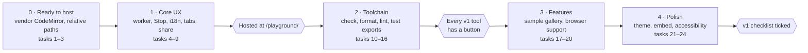

# Asili Playground — Implementation Plan

As of 7 November 2026 · Victor Kaiuki

Five phases. Phases 0 and 1 change only this repo; Phase 2 needs new exports from the Asili repo's
`driver/wasm`, which is where most of the work is.

## Roadmap

## Task tracker

| # | Task | Repo | Covers | Phase | Status |
| --- | --- | --- | --- | --- | --- |
| 1 | Vendor CodeMirror under `vendor/` with `scripts/vendor.sh`; drop `esm.sh` | asili-playground | PG-NFR-3 | 0 | Not started |
| 2 | Relative asset paths everywhere | asili-playground | PG-NFR-6 | 0 | Not started |
| 3 | README: hosted URL and self-hosting steps | asili-playground | PG-1 | 0 | Not started |
| 4 | Move execution into a Web Worker; Stop button | asili-playground | PG-4 | 1 | Not started |
| 5 | `i18n/sw.json`, `i18n/en.json`; `?lugha=` and `asili-lugha` | asili-playground | PG-2 | 1 | Not started |
| 6 | File tabs and `runBundle` | asili-playground | PG-5 | 1 | Not started |
| 7 | Share links (`#k=`, deflate) | asili-playground | PG-11 | 1 | Not started |
| 8 | `repository_dispatch` to the website on push to `main` | asili-playground | PG-1 | 1 | Not started |
| 9 | Website `site.yml` builds and hosts `/playground/` | website | PG-1 | 1 | Not started |
| 10 | Confirm `pata-fmt` and `pata-lint` build for wasm; split features if not | Asili | PG-6, PG-7 | 2 | Not started |
| 11 | Wasm export `check(files)` with structured diagnostics | Asili | PG-3, PG-8 | 2 | Not started |
| 12 | Structured runtime errors from `run` and `runBundle` | Asili | PG-3 | 2 | Not started |
| 13 | Wasm export `format(source)` | Asili | PG-6 | 2 | Not started |
| 14 | Wasm export `lint(files)` | Asili | PG-7 | 2 | Not started |
| 15 | Wasm export `test(files)` | Asili | PG-9 | 2 | Not started |
| 16 | Tool bar buttons, Matatizo and Majaribio panels, editor marks | asili-playground | PG-3, PG-6–9 | 2 | Not started |
| 17 | Audit which stdlib modules work in the browser | Asili | PG-13 | 3 | Not started |
| 18 | Sample per language area and per browser-capable module | asili-playground | PG-10 | 3 | Not started |
| 19 | Browser support panel | asili-playground | PG-13 | 3 | Not started |
| 20 | CI: samples agree with native `pata` | asili-playground | PG-NFR-4 | 3 | Not started |
| 21 | Light and dark editor themes from the brand tokens | asili-playground | Design Brief | 4 | Not started |
| 22 | Embed mode `?embed=1` | asili-playground | PG-12 | 4 | Not started |
| 23 | Keyboard and screen-reader pass | asili-playground | PG-NFR-5 | 4 | Not started |
| 24 | Wasm size budget and no-external-request check in CI | asili-playground | PG-NFR-1–3 | 4 | Not started |

v2 (after launch): trace tab (`trace` export), hover and completion in a worker, REPL panel,
download of the built wasm.

## Decisions needed

| Decision | Blocks | Recommendation |
| --- | --- | --- |
| Share links in the URL only | Task 7 | Yes for v1; Gist export later if links get too long |
| Format on Run by default | Task 16 | No; a setting, off by default |
| Editor theme replaces One Dark | Task 21 | Yes, so the editor matches the site |

## Launch checklist

- [ ] `/playground/` loads with no third-party request and is interactive within 5 s on throttled 3G.
- [ ] Run, Stop, Format, Lint, Check-as-you-type and Test work on every sample.
- [ ] Every language area has a sample; modules that need a file system or network are explained.
- [ ] Share links round-trip; embed mode works inside the website and a wiki-style page.
- [ ] Swahili and English interfaces complete; native-speaker review done.
- [ ] `build.sh` then `pata jenga --tenda` serves the same playground locally.
